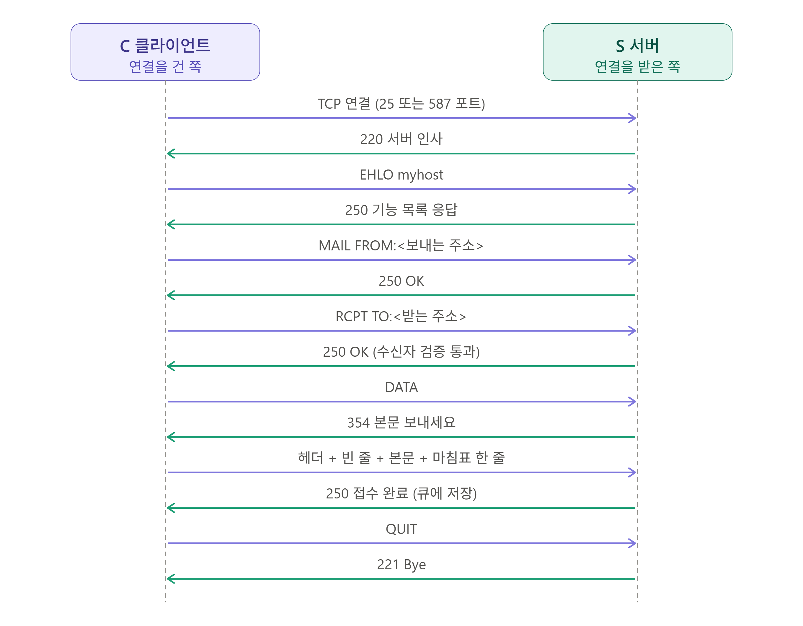

# 01_메일의 큰 그림

> 메일 동작 원리, 흐름 등

## 1. 메일은 어떻게 동작하는가

> 텍스트 기반 프로토콜

### 1) 텍스트 기반 프로토콜

메일은 클라이언트가 명령 한 줄을 보내면 서버가 응답하는 요청 - 응답 구조의 텍스트(ASCII) 기반의 프로토콜이다.

- 간단하게 서버쪽으로 TCP 연결을 한 다음에 클라이언트가 ELOH (HELLO의 역) - MAIL FROM (보내는 주소) - RCPT TO (받는 주소) - 마침표 등 한 줄씩 텍스트로 서버로 요청을 보내고 응답을 받는 과정을 거쳐 이루어진다.
- SMTP 세션 하나의 동작 흐름.
  - ※ 전체가 SMTP 통신의 1개 세션임! 즉, 메일을 보내면서 SMTP 세션이 2개 이상 주고 받기 때문에 이러한 전체 과정이 여러 번 일어날 수 있음

```
TCP 연결 → 서버 인사(220) → EHLO → MAIL FROM → RCPT TO → DATA(354) → 헤더+본문 → "." → 접수(250) → QUIT(221) → 연결 종료
```

한글이나 첨부파일(바이너리)를 보내려면 Base64 인코딩 과정이 필요하다.

<br>

### 2) 역할 구분

> MUA / MTA / MDA / MSA, 메일 박스(저장소)

#### (1) MUA (Mail User Agent)

사용자가 쓰는 메일 프로그램 (OutLook, Gmail 웹, 모바일 앱, 웹 메일 등)

- 편지를 쓰는 사람, 클라이언트

#### (2) MSA (Mail Submission Agent)

MUA가 보낸 메일은 인증 후 접수하는 창구 (587, 25 SMTP)

- 우체국 접수 창구

#### (3) MTA (Mail Transfer Agent)

서버 간 **중계**(`발신 MTA`와 `수신 MTA`가 존재). 수신자 도메인의 MX 레코드를 찾아 해당 서버로 전달하는 역할.

- 각 우체국 간 집배 (우체국 to 우체국)

#### (4) MDA (Mail Delivery Agent)

도착한 메일을 사용자 수신함에 저장 (필터, 스팸 처리)

- 집배원이 수신자의 수신함에 넣음

#### (5) Mail Box (메일함)

메일이 실제로 저장되는 곳 (디스크, 파일 시스템)

<br>

## 2. 발송부터 수신까지 전체 흐름

### 1) 단계별 흐름

1. 발신자가 MUA에서 발송을 누르면, MUA가 **SMTP (587번 또는 465번)**로 발신자의 메일 서버(`발신 MTA`)에 메일을 넘김. (서버에서는 인증 후 메일을 접수함)
2. 발신 MTA는 수신자의 주소 `@` 뒤 도메인으로 **DNS에서 MX 레코드를 조회**해 상대 메일 서버 주소 조회.
3. 발신 MTA가 수신 MTA로 **SMTP (25번)**로 전달.
4. 수신 MTA가 MDA에 넘기고, MDA가 수신자 메일박스에 저장. (스팸 필터링, 파일 저장)
5. 수신자가 MUA로 **IMAP (143, 993) 또는 POP3 (110, 995)**를 통해 메일박스에서 메일을 가져옵니다.

<br>

### 2) SMTP 세션

MUA와 발신 MTA 간, 발신 MTA와 수신 MTA 간 차이.

| 구분       | MUA → 발신 MTA              | 발신 MTA → 수신 MTA                    |
| ---------- | --------------------------- | -------------------------------------- |
| 포트       | 587, 465                    | 25                                     |
| 인증(AUTH) | 필수(아이디, 비밀번호)      | 일반적으로 없음                        |
| 암호화     | 대부분 필수                 | 있으면 사용                            |
| 목적       | "이 메일을 대신 보내주세요" | "이 메일을 당신쪽 사용자에게 보내줘요" |

<br>

### 3) SMTP 단계별 도식화



- 각 단계별로 서버 상에서 발생하는 일

| 단계                                     | 서버 내부 (정상 응답)                                        | 실패 시                                                      |
| ---------------------------------------- | ------------------------------------------------------------ | ------------------------------------------------------------ |
| TCP 연결                                 | 접속 IP 허용 여부, 동시 접속 수 확인 후 인사 (`220`)         | 연결 timeout/refused, 인사 없음, `421`(서비스 불가), `554`(접속 거부) |
| EHLO (클라이언트)                        | 지원 기능 목록 응답 (`250`). STARTTLS, AUTH, SIZE, 8BITMIME 등 | 호스트명 검증 실패. `500`, `501` (문법 오류 등)              |
| MAIL FROM                                | 발신자 접수. 서버 정책에 따라 인증 여부, 발신 도메인 존재 여부 검사. (`250`) | `530`(인증 필요), `550`(발신자 거부)                         |
| RCPT TO                                  | 수신자 검증. 이 서버가 처리할 주소인지, 사용자가 존재하는지 확인. 수신자가 여러 명이면 이 줄을 반복. (`250`) | `550` (없는 사용자), `450` / `452` (일시적 실패), `550 5.7.1` 류의 릴레이(relay) 거부; (우리 서버 대상이 아닌데 인증도 없음) |
| DATA                                     | 데이터(헤더 및 본문 등)를 보내세요 (`354`)                   | `503` (명령 순서 오류; RCPT 없이 DATA부터 보냄 등)           |
| 헤더 + 빈줄(`\r\n`) + 본문 + 마침표(`.`) | 마침표(`.`)를 만나면 본문 종료. 크기 제한, 스팸/바이러스 검사 후 큐에 저장 후 응답 (`250`) | `552`(크기 초과), `554`(내용 거절)                           |
| QUIT                                     | SMTP 세션 종료                                               | -                                                            |

- 본문 전달 이후 받은 `250` 접수 완료 (store-and-forward) 응답의 의미
  - "내가 책임지고 이 메일을 보관했다"일뿐 실제로 "상대방에게 도착했음"이 아님.
  - 이후 상대방 메일 서버의 MX레코드 DNS조회 (mx 레코드 우선순위 숫자가 낮은 순서부터 우선 조회. 없으면 A레코드 폴백)
  - 전달 중 `4xx`나 연결 실패가 발생하면 큐에 메일을 남겨두고 간격을 늘려가며 재시도. (보관 기간은 서버마다 상이.)
  - `5xx`를 응답받으면 재시도를 포기하고, 발신자에게 **반송메일(NDR)**을 리턴. (재시도 기간이 끝나도 못 보내면 마찬가지로 반송)

### 4) NDR (Non-Delivery Report)

반송 사유 (발송 실패 사유).

일반적으로는 **상대(수신) MTA가 우리 서버에 준 실패 응답**(`5xx`) 사유 인용한 메세지를 NDR이라고 한다. 

- 상대방쪽에서 `4xx` 응답을 계속 주면서 지속적인 재시도 실패 시에는 NDR에 `4xx` 혹은 시간 초과 등의 문구가 있음.
- 상대와 연결 자체가 안 됐을 때는 NDR에 상대방 응답 코드가 없고, 우리 서버의 사유 등이 있을 수 있음.
- DNS 조회 단계에서 실패했을 때에도 상대방 응답 코드가 없고, 우리 서버에서 만든 코드가 있음.

단, 항상 그런 것은 아니며, 실패 사유는 우리쪽에 있을 수도 있기 때문에 NDR 메세지를 잘 읽을 수 있어야 한다.

- `Reporting-MTA`: 누가 이 NDR을 만들었나? (보통 우리 서버; 우리가 NDR을 만들든, 상대방이 실패하더라도 NDR은 우리 서버가 생성하는 경우가 일반적)
- `Remote-MTA` 유무: 상대 서버와 실제로 대화가 이뤄졌었나? (Remote-MTA가 없을 경우에는 DNS 및 연결 문제)
- `Diagnostic-Code` 원문: 상대방 응답이 무엇이었나? 혹은 우리 서버의 문구인가?
- `Status` 상세 코드: `5.1.1`, `5.7.1` 등 원인 확인

```
Reporting-MTA: dns; mail.우리회사.com        ← NDR을 만든 서버 (우리 쪽)
Final-Recipient: rfc822; b@receiver.com     ← 실패한 수신자
Action: failed                              ← 최종 실패 (failed / delayed)
Status: 5.1.1                               ← 상세 상태 코드
Remote-MTA: dns; mx.receiver.com            ← 거절한 상대 서버
Diagnostic-Code: smtp; 550 5.1.1 User unknown   ← 상대 서버가 준 응답 원문
```

