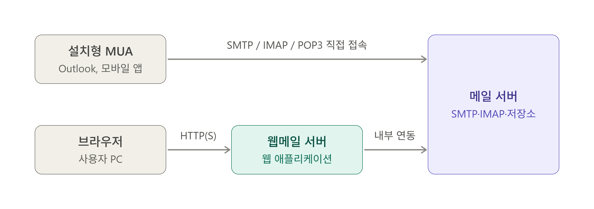

# 02_웹 메일

> 웹 메일에 대한 정리

<br>

## 1. 웹 메일이란?

웹 메일이란 **브라우저로 메일을 읽고 쓰는 서비스**를 말한다.

구조상의 핵심은 MUA(Mail User Agent)의 역할이 사용자의 PC가 아니라 서버쪽의 웹 어플리케이션이라는 점이다.

### 1) 설치형 MUA

Outlook (설치된 앱, 웹 Outlook 아님), 모바일 메일 앱 등 **사용자 단말이 직접 메일 서버와 SMTP, IMAP / POP3 프로토콜로 대화**하는 MUA 프로그램을 말한다.

<br>

### 2) 웹 메일

사용자는 브라우저로 메일 서비스를 이용하며, 브라우저는 HTTP(S)로 웹 서버하고만 통신하고, **메일 서버와의 대화는 웹 어플리케이션(웹 앱)이 대신하는 형태**를 말한다.

보다 정확히 말하자면, **웹 어플리케이션이 MUA 역할**을 한다고 보면 된다.

```
브라우저 ──HTTPS──> 웹 서버(nginx 등) ──프록시──> 웹 애플리케이션 (MUA) ──> 메일 서버
                   TLS, 용량 제한,              로그인, 목록 조회,
                   정적 파일, 전달               MIME 조립, 발송 요청
```

<br>

### 3) 도식화



| 항목                           | 설치형 MUA                                   | 웹 메일                                          |
| ------------------------------ | -------------------------------------------- | ------------------------------------------------ |
| MUA의 위치                     | 사용자의 단말(PC, 모바일 등)                 | 서버의 웹 어플리케이션                           |
| 클라이언트가 사용하는 프로토콜 | SMTP, IMAP / POP3                            | HTTP(S)                                          |
| 사용자가 설정하는 것           | 서버 주소, 포트, 암호화 방식, 계정 정보 등   | 접속 URL, 로그인 등                              |
| 로그인 방식 (인증 방식)        | SMTP AUTH, IMAP 로그인                       | 웹 로그인 (세션)                                 |
| 장애가 발생하는 계층           | 클라리언트 설정, 네트워크, 메일 서버 문제 등 | 브라우저, 웹 서버, 웹 앱, 메일 서버, 네트워크 등 |

<br>

## 2. 동작 과정

### 1) 발신

1. 사용자가 작성 화면에서 수신자, 제목, 본문, 첨부를 입력하고 보내기를 누르면, 브라우저가 이 내용을 **HTTP(S) 요청으로 웹 서버에 업로드**.
2. 웹 어플리케이션이 웹 서버로부터 이 값들을 받아서 **메일 형식(헤더 + MIME 본문)으로 조립**합니다. (웹 어플리케이션이 메일 구조 생성).
3. 조립한 메일을 메일 서버에 전달. (SMTP 통신, MX 레코드 조회, MTA 서버 간 전달, 수신 서버 접수 등)

<br>

### 2) 수신

1. 사용자가 목록이나 메일 보기를 클릭하면 브라우저가 HTTP(S) 요청을 보냄.
2. 웹 애플리케이션이 메일박스에서 메일(파일)을 읽어 **HTML 화면으로 만들어** 응답.
3. **사용자 PC로 메일 파일이 통째로 내려오지 않고, 화면에 필요한 내용만 전달**.

<br>

### 3) 웹 어플리케이션과 메일 서버 연동

웹 앱이 메일 서버와 연동하는 방식에는 아래와 같이 다양한 형태가 존재한다. (웹 메일 서비스마다 상이할 수 있음)

- 웹 앱이 직접 메일 서버에 SMTP, IMAP / POP3로 붙는 형태
- 서버 내부 API나 저장소를 직접 읽는 형태

하지만 핵심은 웹 메일은 결국 "웹 어플리케이션이 내부적으로 메일 서버와 연동한다"이다.

<br>

## 3. 장애 원인 추적 포인트

웹 메일의 경우 웹 서버, 웹 어플리케이션, 메일 서버 이렇게 크게 나뉘기 때문에 어떤 문제가 발생했을 때 각 계층별로 체크해야할 장애 원인 추적 포인트가 있을 수밖에 없다.

예를 들어 웹 메일 첨부 파일 문제가 있을 때, 각 증상 별로 확인해야 할 계층이 정해져있다.

| 증상                                   | 계층            | 확인해야 할 포인트                                           |
| -------------------------------------- | --------------- | ------------------------------------------------------------ |
| 첨부파일 업로드 중 실패                | 웹 서버 / 웹 앱 | 웹 서버: nginx의 `client _max_body_size` 와 같은 업로드 용량 제한은 없는지?<br />웹 앱: 어플리케이션 레벨에서 첨부 용량 제한은 없는지? |
| 업로드는 완료됐으나 보내기 시 오류     | 메일 서버       | 메일 크기 제한 (SMTP 552 에러)                               |
| 보내기는 성공했으나 수신자가 받지 못함 | 큐, 수신 서버   | 큐에서 실제 메일이 나갔는지, 수신 서버에서 잘 받았는지 등 확인 |

