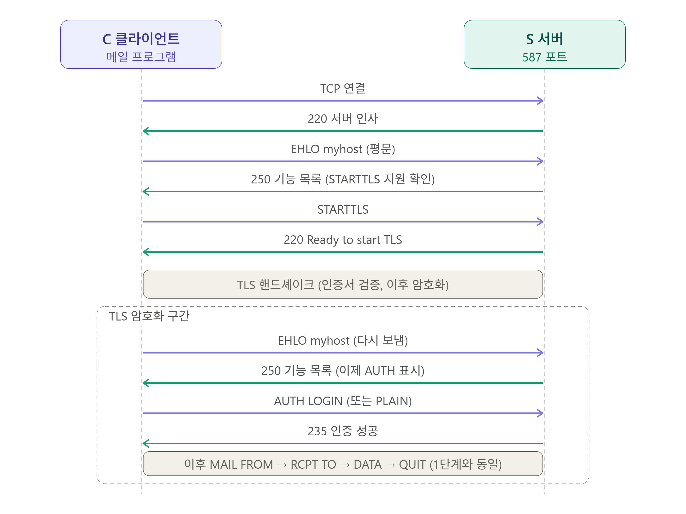

# 03_메일 프로토콜 (SMTP, IMAP, POP3)

> SMTP, IMAP, POP3 프로토콜 정리

이메일 송신, 수신 프로토콜


### 1) 개요

|           | SMTP                 | IMAP                                    | POP3                |
| --------- | -------------------- | --------------------------------------- | ------------------- |
| 용도      | 보내기, 서버 간 전달 | 메일함은 서버에 둔채 메일만 조회 / 관리 | 메일함에서 가져오기 |
| 포트      | 25, 587 (STARTTLS)   | 143                                     | 110                 |
| TLS 포트  | 465                  | 993                                     | 995                 |
| 응답 형식 | 숫자 코드 250        | 태그 + OK / NO / BAD                    | +OK / -ERR          |

<br>

## 1. SMTP

> Simple Mail Transfer Protocol

PUSH 방식의 메일 송신(발신) 전용 프로토콜 (보내는 쪽이 능동적).

메일을 송신(발신)하는데 사용되는 TCP/IP 표준 프로토콜로, 클라이언트가 자기 메일 서버에 메일을 제출할 때 사용하는 프로토콜이다. 메일 서버끼리 메일을 전달(relay)할 때도 사용한다.

### 1) 특징

#### (1) 텍스트 기반 프로토콜

텍스트 기반 명령어(`EHLO`, `MAIL FROM`, `RCPT TO`, `DATA`, `QUIT`)

- `EHLO`: 인사 / SMTP 서버 기능 목록 요청
- `STARTTLS`: 평문 연결을 TLS 연결로 전환. (EHLO로 250 응답을 받아 TLS 기능을 지원할 경우 STARTTLS 명령어 송신)
- `AUTH`: 로그인 (587, 465에서 사용)
- `MAIL FROM`: 메일 발신자(송신자)
  - 반송 메일의 경우 `MAIL FROM: <>` (빈 주소)를 사용한다. 반송의 반송이 무한 반복되는 걸 막기 위해 빈 주소를 쓰는 것이다.
- `RCPT TO`: 메일 수신자 (수신자가 여러 명일 경우 여러 번 반복 가능)
- `DATA`: 본문 시작 (본문 종료 시 `.` 전달 필요)
- `RSET`: 진행 중인 메일 취소 (연결은 유지하고 MAIL FROM으로 돌아감)
- `NOOP`: 아무 동작 없음. 단순 연결 유지 확인용
- `VRFY` / `EXPN`: 주소 존재 확인 / 목록 확장
- `QUIT`: 종료 (SMTP 세션 종료)

#### (2) TCP / IP 기반 프로토콜

- TCP/IP의 특징처럼 `연결 확인 - 연결 - 신호 전달`과 같은 단계를 거친다. (메일 보내기)
- `SMTP 서버로의 접근 가능성 확인 - 서버와 연결 설정 - 메일 전송` (서버 간 전달)

#### (3) 구성

(SMTP) 클라이언트와 SMTP 서버로 구성된다.

- 사용 포트

  - 25: smtp 서버 to 서버

  - 587: 클라이언트 to 서버

  - 465: 클라이언트 to 서버 (SMTPS 보안 통신)

<br>

### 2) 클라이언트와 SMTP 서버 및 동작 과정

SMTP 클라이언트 - 보내는 SMTP 서버 - SMTP 받는 서버의 구성

#### (1) SMTP 클라이언트

메일을 보낸 주체 (발신자, 송신자).

※ 메일을 받는 상대방(수신자) 은 클라이언트가 아니다.

- 왜냐하면 SMTP 클라이언트가 SMTP 서버로 데이터를 보내고 받는 쪽은 해당 서버로부터 메세지를 수신만 받기 때문이다.
  - 클라이언트(발신자, 송신자)가 능동적으로 SMTP를 통해서 수신자에게 보내는 행위이기 때문에 발신자가 클라이언트고 수신자는 클라이언트가 아니다.

#### (2) SMTP 서버

메일 데이터를 송/수신하는 서버 (보내는 서버와 받는 서버)

- 예를 들어, gmail의 SMTP 서버는 smtp.gmail.com이고, naver의 SMTP 서버는 smtp.naver.com이다.

클라이언트가 본인의 메일 주소로 메일을 보내면 해당 메일 데이터는 클라이언트가 사용하는 메일 도메인의 메일 서버로 1차적으로 보내진 다음에, 수신측의 메일 서버로 보내지는 과정을 거친다.

- 예) gmail → naver로 메일 송신 시; 클라이언트 메일 작성(gmail) → gmail SMTP서버 → naver SMTP서버

#### (3) 동작 과정

송신자(클라이언트)가 메일을 작성해서 보내면 해당 메일이 SMTP 서버(보내는 메일 서버, Outgoing Mail Server)로 전송되며, 메일을 받은 SMTP 서버는 SENDMAIL 프로그램을 구동하여 해당 메일을 알맞은 수신자에게 보낸다.

- ※ DNS와 MX 레코드
  - MX 레코드란 메일이 수신될 위치를 결정하는 레코드를 말한다.

- 동작 예시
  1. mydomain.kr의 MX 레코드를 네이버웍스의 MX 레코드 값으로 설정
  1. 외부에서 id@mydomain.kr로 메일을 보내는 경우
  1. DNS에 네이버웍스의 MX 레코드가 조회되므로 네이버웍스 서버로 메일을 전송
  1. 네이버웍스의 메일함에서 수신된 메일 확인

### 3) SMTP 응답 코드

- 성공
  - `220`: 서비스 준비
  - `221`: 서비스 종료
  - `235`: 인증 성공
  - `250`: 요청 성공
  - `334`: 인증 진행 중 (서버에서 AUTH에 대한 값 요청)
  - `354`: 본문 입력 시작, 본문 입력 요청 (DATA 직후)
- 실패
  - `421`: 서비스 불가, 연결 종료
  - `450` / `451`: 일시 실패
  - `452`: 저장 공간 / 수신자 수 초과 (일시)
  - `500`: 문법 오류
  - `501`: 인자 오류
  - `502`: 미지원 명령
  - `504`: 미지원 인자
  - `503`: 명령 순서 오류 (RCPT 없이 DATA 등)
  - `530`: 인증 필요 (AUTH 없이 발송 시도)
  - `535`: 인증 실패 (AUTH 정보; 아이디, 패스워드 불일치)
  - `550`: 사서함 없음 또는 정책 거절 (상세 코드 `5.1.1`, `5.7.1` 등으로 원인 구분)
  - `552`: 크기 / 용량 초과
  - `553`: 메일함 이름 불허
  - `554`: 처리 실패 (연결 직후 나올 경우 접속 실패)

<br>

### 4) SMTP AUTH

TLS로 암호화 통로를 먼저 만들고, 그 안에서 AUTH로 인증하여 연결 / 전송

| 암호화 방식               | 포트 | 설명                                | 순서                                                         |
| ------------------------- | ---- | ----------------------------------- | ------------------------------------------------------------ |
| STARTTLS                  | 587  | 평문으로 시작한 뒤 TLS로 업그레이드 | 연결 즉시 TLS → `EHLO` → `AUTH` → 발송                       |
| Implicit TLS (암묵적 TLS) | 465  | 연결하자마자 TLS                    | 평문 연결 → `EHLO` → `STARTTLS` → TLS 전환 → `EHLO` 다시 → `AUTH` → 발송 |

- SMTP 25 포트의 경우 서버 간 전달에 사용되며, TLS (암호화)는 있을 경우 사용하며 AUTH는 보통 없음



#### (1) TLS

통신 구간을 암호화하고 서버 인증서를 검증하는 절차. 

통신 위변조, 하이재킹 방지.

#### (2) AUTH

"누가 보내는가"를 로그인(AUTH)로 확인하려는 절차.

아무나 우리 서버로 메일을 중계하지 못하도록 막음.

- ※ SMTP AUTH는 사용자 인증(사용자가 자기 메일 서버에 발송을 맡기는 구간)으로 SPF/DKIM/DMARK와 같이 도메인 인증("이 도메인 이름으로 보낼 자격이 있는가")과 다름.
- 웹 메일에서 로그인은 SMTP AUTH가 아님을 유의!

<br>

## 2. IMAP / POP3

> PULL 방식의 메일 수신 전용 프로토콜 (받는 쪽이 능동적)

클라이언트가 서버로 메일을 달라고 요청하는 클라이언트 to 서버 요청의 프로토콜.

SMTP가 보내는 사람(발신자, 송신자)가 클라이언트였다면, IMAP / POP3에서는 메일을 받는 사람(수신자)가 클라이언트가 된다.

### 1) IMAP

> Internet Message Access Protocol

메일을 수신하기 위한 프로토콜로, IMAP의 수신은 "**동기화하며 받는 것**"을 의미한다.

#### (1) 특징

POP3에 비해 모던한 방식의 프로토콜이며, 현대의 대부분의 메일 서비스는 IMAP을 기본으로 한다.

헤더만 먼저 받고 본문은 필요할 때 가져오는 식의 부분 다운로드 기능도 지원한다.

##### 메일 동기화

메일 데이터는 서버에 그대로 두고, 클라이언트는 해당 메일 데이터를 동기화만 한다.

- 원본(master copy)는 서버에 저장되어 있고, 클라이언트는 메일 데이터를 보여주기 위한 로컬 캐시만 가져간다.
  - 따라서 모든 변경의 진실의 원천(source of truth)은 서버에 있다.
- 따라서 여러 기기에서도 같은 상태로 메일을 열람할 수 있다.

※ 단, **클라이언트에서 삭제를 하면 서버에서도 삭제**된다. (COPY, MOVE 등 폴더 간 이동 및 복사도 서버로 전달되어 처리됨)

- `\ Deleted` (삭제 예정) → `EXPUNGE` (완전 삭제)

##### POP3와의 차이점

- POP3가 메일 데이터를 클라이언트로 가져와서 저장한 다음 서버에서 삭제하는 것과는 다른 차이점.

- POP3와 달리 폴더의 개념이 존재하며, 읽음/안읽음 및 플래그 등의 상태관리가 가능.

#### (2) 사용 포트

- `143`: 클라이언트 to 서버 (메일 수신)
- `993`(TLS): 클라이언트 to 서버 (메일 수신, IMAPS)

#### (3) 동작 방식

명령(요청)마다 태그(`a001` 등)를 붙이고, 서버는 정보 줄은 `*`로 시작하고 마지막에 같은 태그와 함께 결과(`OK` / `BAD` / `NO`)를 돌려주는 방식으로 동작함. (즉, 요청 태그에 따른 응답을 태그별로 전달해주는 형태)

세션에 상태는 4개 존재한다.

- Not Authenticated: 로그인 전
- Authenticated: 로그인 후, 폴더 선택 전
- Selected: 폴더를 열어 둔 상태 (메일 조회/수정)
- Logout: 로그 아웃

```
S: * OK IMAP4rev1 ready
C: a001 LOGIN siwon ********
S: a001 OK LOGIN completed
C: a002 LIST "" "*"                     ← 폴더 목록
S: * LIST (\HasNoChildren) "/" "INBOX"
S: * LIST (\HasNoChildren) "/" "Sent"
S: a002 OK LIST completed
C: a003 SELECT INBOX                    ← 폴더 열기
S: * 12 EXISTS                          ← 메일 12통
S: a003 OK [READ-WRITE] SELECT completed
C: a004 FETCH 1:3 (FLAGS BODY[HEADER.FIELDS (SUBJECT FROM)])
S: * 1 FETCH (...)                      ← 헤더 일부만 가져옴
S: a004 OK FETCH completed
C: a005 STORE 1 +FLAGS (\Seen)          ← 읽음 표시
S: a005 OK STORE completed
C: a006 LOGOUT
S: * BYE
S: a006 OK LOGOUT completed
```

<br>

### 2) POP3

> Post Office Protocol v3

메일을 수신하기 위한 프로토콜로, POP3의 수신은 "**받아오기", "꺼내오기**"를 의미한다.

**내 단말로 다운로드, 내려받는 방식**이다.

#### (1) 특징

- 서버로부터 클라이언트로 메일을 직접 다운로드한다. (데이터는 건드리지 않고 동기화하는 IMAP과 차이)
- 하나의 기기에서 (오프라인으로) 메일을 본다는 가정을 한다. 따라서 동기화가 되지 않으며, 다른 기기에서보면 메일이 없을 수 있다.
- 과거에는 다운로드 후 삭제하는 방식이 기본 동작이었지만, 현재는 클라이언트의 설정에 따라 다를 수 있다. 따라서, 메일이 갑자기 삭제되었다고 할 때 POP3로 인한 문제일 가능성이 높지만, 무조건 POP3가 범인은 아닐 수도 있다.

#### (2) 사용 포트

- `110`: 클라이언트 to 서버 (메일 수신)
- `995`(TLS): 클라이언트 to 서버 (메일 수신 보안 통신, POP3S)

#### (3) 동작 방식

서버의 메일 박스의 메일을 내 단말로 내려받는 방식으로 동작한다.

응답은 `+OK` / `-ERR`로 이뤄져있다.

세션에는 다음과 같이 3개의 상태가 존재한다.

- AUTHORIZATION: 로그인 (`USER`/`PASS`)
- TRANSACTION: 목록, 조회, 삭제 표시
- UPDATE: `QUIT` 시점에 삭제 표시한 메일을 **실제로 삭제**

```
S: +OK POP3 server ready
C: USER siwon
S: +OK
C: PASS ********
S: +OK Logged in
C: STAT
S: +OK 3 120456              ← 3통, 합계 120,456 바이트
C: LIST
S: +OK 3 messages
S: 1 2300
S: 2 98000
S: 3 20156
S: .
C: RETR 1                    ← 1번 메일 원문 전체 다운로드
S: +OK 2300 octets
S: (메일 원문)
S: .
C: DELE 1                    ← 삭제 "표시"만
S: +OK marked deleted
C: QUIT
S: +OK bye                   ← 이 시점에 실제 메일 삭제
```

메일을 내려받은 후 삭제는 `RETR` → `DELE` → `QUIT`까지 정상적으로 종료되었을 경우에 삭제된다.

- `RETR`만 하고 끝나면 메일은 서버에 그대로 남게 된다.
- `DELE` 후 `QUIT` 없이 연결이 끊겨도 메일은 서버에 그대로 남으며, 이때는 삭제 표시는 취소된다.

| 명령     | 서버에서 일어나는 일                                      |
| -------- | --------------------------------------------------------- |
| `RETR 1` | 1번 메일을 내려받기 함. 서버상에 메일은 그대로 남아 있음. |
| `DELE 1` | 1번 메일에 삭제 표시를 함.                                |
| `QUIT`   | 삭제 표시된 메일이 실제로 삭제됨 (UPDATE)                 |

따라서 **내려받고 삭제하는 것은 클라이언트의 설정에 따라 결정**된다.

- "서버에 사본 남기기" 켬: `RETR`만 하고 `DELE`는 보내지 않음. 이 때 이미 받은 메일은 UIDL (메일별 고유 ID)로 구별해서 다음 접속 시에 중복으로 다운로드하지 않음.
- "서버에 사본 남기기" 끔: `RETR` 후 `DELE`를 보내고 `QUIT` (다운로드 후 서버의 메일을 삭제하겠다는 의도)
- "N일 후 서버에서 삭제": 내려받은 메일을 기억해 두었다가, N일이 지난 후 나중에 접속 시 `DELE`를 보내고 `QUIT`함.

<br>

### 3) 요약

| 항목              | IMAP                                        | POP3                                        |
| ----------------- | ------------------------------------------- | ------------------------------------------- |
| 메일 위치         | 서버에 보관                                 | 클라이언트의 단말기                         |
| 폴더              | 서버 폴더 지원                              | 받은 편지함만                               |
| 읽음 상태(플래그) | 서버에 저장되어 동기화                      | 동기화되지 않음                             |
| 여러 기기 지원    | 적합 (동기화)                               | 불편                                        |
| 서버 용량         | 서버의 메일함 용량을 사용                   | 단말에서 관리 (서버 용량과 별개)            |
| 네트워크          | 접속 상태에서 필요한 만큼 조회              | 한 번에 받고 오프라인 열람 가능             |
| 메일 삭제         | 서버에서 파일 삭제 혹은 클라이언트에서 삭제 | 클라이언트의 옵션을 따름 (내려받은 후 삭제) |

