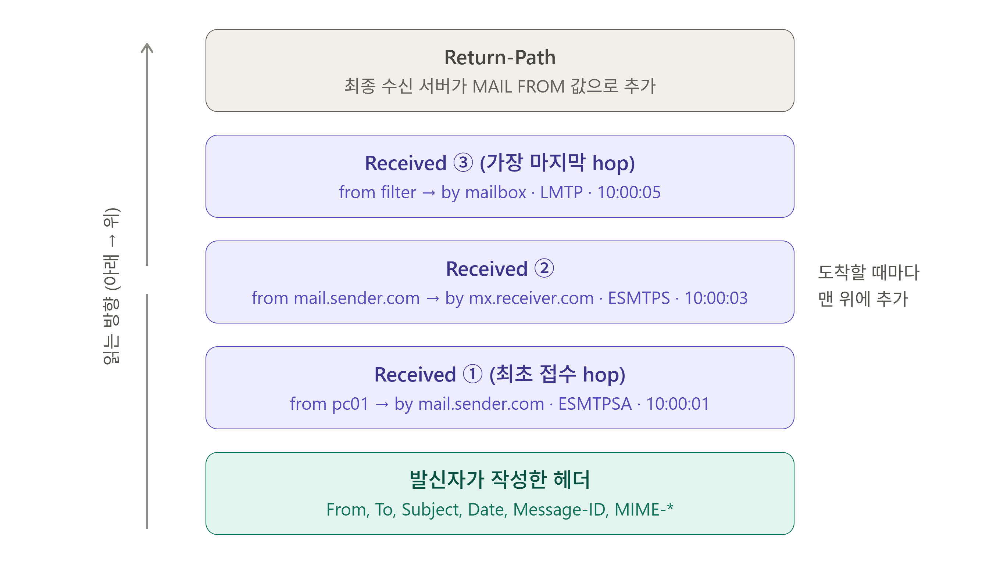

# 04_메일 메시지 구조

> DATA로 실어 보내는 메일 자체의 구조

## 1. 봉투(Envelope)와 메세지(Header + Body)

메일은 봉투와 메시지, 2개의 계층으로 이루어져있다.

|                    | 봉투 (Envelope)                           | 메시지 (Header + Body)                          |
| ------------------ | ----------------------------------------- | ----------------------------------------------- |
| 어디에 있나 (위치) | SMTP 명령 (`MAIL FROM`, `RCPT TO`)        | `DATA`안에 들어가는 내용                        |
| 누가 쓰나 (목적)   | 서버가 라우팅에 사용 (누구에게 보낼지 등) | 사람과 메일 프로그램이 보는 내용                |
| 비유               | 봉투 겉면의 주소                          | 편지지 안의 받는 사람 / 보낸 사람 문구, 내용 등 |

### 1) 차이점

봉투와 메세지의 헤더를 보면 `MAIL FROM`과 `From:`, `RCPT TO`와 `To:` 등 비슷한 성격의 내용이 존재하여 중복이 되는 것 같지만, 이 둘은 서로 다를 수도 있다.

- 참조(Bcc): 숨은 참조 수신자는 RCPT TO에는 있지만 메시지의 헤더에는 없다.
- 메일링 리스트: 메시지 헤더의 `To:`는 리스트 주소지만, 봉투의 RCPT TO는 리스트 구성원의 개별 주소이다. (즉, 봉투에 쓰여있는 수신자의 주소랑 실제 메일 수신자의 주소가 다를 수도 있다.)
- 발송 역시 마찬가지로 MAIL FROM과 From: (사람이 보는 주소)가 실제로는 상이할 수도 있다.

```
(봉투)  MAIL FROM:<bounce@mailservice.com>
        RCPT TO:<b@receiver.com>
(메시지) Return-Path: <bounce@mailservice.com>   ← 수신 서버가 추가
        From: news@company.com                  ← 사람이 보는 발신자
        To: b@receiver.com
```

<br>

## 2. 메일 메시지의 기본 형식

메일 메시지의 기본 형식은 RFC 5322를 따른다.

```
헤더 이름2: 값
헤더 이름1: 값
(빈 줄)
본문
```

### 1) 구성

줄 길이는 권장 78자, 최대 998자로 이를 넘어갈 경우 서버나 장비에서 임의로 줄바꿈이 들어가 내용이 깨질 수도 있다.

#### (1) 헤더

헤더는 `이름(키): 값`형태로 한 줄씩이며, 헤더는 여러 개 존재할 수도 있다.

헤더의 값이 길 경우 다음 줄을 공백 혹은 탭으로 시작해서 이어서 쓰는 방식을 적용한다.

주요 헤더로는 `From`, `To`, `Cc`, `Subject`, `Date`, `Message-ID`, `Reply-To` 등이 있다.

#### (2) 빈줄

헤더와 본문을 구분하기 위한 경계.

#### (3) 본문

수신자에게 전달할 내용 그 자체.

<br>

## 3. 메일 헤더 (Header)

메일 헤더는 이 메일이 어떤 경로로 왔고, 어디서 시간이 걸렸고, 누가 어떤 정보를 적었는지를 담고 있어서, 일반적으로 메일 관련 장애가 발생했을 때 가장 먼저 확인해보는 데이터이다.

### 1) 헤더의 종류

헤더는 발신자/수신자, 일자 등의 정보가 담긴 작성 헤더와 메일이 지나간 서버들에 대한 정보가 담긴 추적 헤더가 있다.

| 구분      | 작성자                             | 헤더 종류                                           | 신뢰성                                 |
| --------- | ---------------------------------- | --------------------------------------------------- | -------------------------------------- |
| 작성 헤더 | 발신자 (메일 프로그램, 웹 메일 등) | `From`, `To`, `Subject`, `Date`, `Message-ID`       | 위변조 가능                            |
| 추적 헤더 | 메일이 지나간 서버                 | `Received`, `Return-Path`, `Authentication-Results` | 작성한 메일 서버를 신뢰할 수 있을 때만 |

헤더는 텍스트라서 누구나 작성할 수 있다. 그래서 그만큼 위변조가 쉬워서 무작정 신뢰하면 안 된다. 따라서 보통은 우리 서버가 작성한 헤더는 신뢰하고, 외부에서 작성한 헤더는 참고용으로 본다.

<br>

### 2) 주요 헤더

| 헤더                        | 의미                                     | 작성자              | 비고                                            |
| --------------------------- | ---------------------------------------- | ------------------- | ----------------------------------------------- |
| `From`                      | 메일에 보이는 발신자                     | 발신자              | 봉투의 MAIL FROM과 다를 수 있음                 |
| `Sender`                    | 실제로 보낸 주체 (대리 발송 시)          | 발신자              | `From`과 다르다면 대리 발송임                   |
| `To`, `Cc`                  | 헤더상의 수신자                          | 발신자              | 실제 수신자(RCPT TO)와 다를 수 있음             |
| `Bcc`                       | 숨은 참조                                | -                   | 수신본에는 보통 없음                            |
| `Reply-To`                  | 답장 받을 주소                           | 발신자              | 피싱에 자주 악용되는 경우가 있음                |
| `Subject`                   | 제목                                     | 발신자              |                                                 |
| `Date`                      | 작성 시각 + 타임존                       | 발신자              | 발신 PC의 시계값을 따라가기 때문에 틀릴 수 있음 |
| `Message-ID`                | 메일 고유 식별자                         | 최초 접수 시점      | 서버 로그 검색의 공통키로 사용됨                |
| `In-Reply-To`, `References` | 답장 대상 메일의 Message-ID              | 발신자              | 대화 스레드 연결                                |
| `Return-Path`               | 반송 주소(봉투의 `MAIL FROM`)            | 최종 수신 서버(MDA) | NDR 리턴 메일이 가야할 곳                       |
| `Received`                  | 경유 서버 기록                           | 각 서버             |                                                 |
| `Authentication-Results`    | 발신 인증 검증 결과(SPF, DKIM, DMARC 등) | 수신 서버           |                                                 |

- `To` / `Cc`
  - 실제 수신자는 봉투의 `RCPT TO`가 정한다. 
  - `.eml`파일 상에는 봉투를 확인할 수 없으므로 실제 수신자를 확인하려면 `Received` 헤더의 `for`를 보면 된다. (수신자 1명인 경우) 혹은 서버 로그 상에는 RCPT TO가 남으므로 정확한 실제 수신자 확인은 서버 로그를 확인하는게 좋다.
  - `To`헤더 안에는 표시 이름과 실제 주소가 들어가 있다.
    - 일반적으로는 `To`헤더 안의 주소와 `RCPT TO`가 같은 것이 정상이다.
    - Bcc (숨은 참조), 메일링 리스트, 그룹 메일, 별칭 계정, 자동 전달 (대리 발송)의 경우 다를 수 있다.
    - 위변조/스팸일 경우에도 실제 주소와 RCPT TO가 다를 수 있다.
  - 메일링 리스트: 헤더 `To:`에는 `list@회사.com`과 같은 주소가 하나 작성되어 있지만, 실제 받는 사용자는 여러 명일 수 있다. (예- 해당 주소가 부서 대표 메일인 경우)

```
To: 박시원 선임(zow777) <zow777@daou.co.kr>
    └ 표시 이름 (화면용)    └ 실제 주소
```

```
[발신자 → 서버]        RCPT TO:<list@회사.com>     ← 발신자가 지정한 건 1개 (서버가 list@회사.com을 구성원으로 확장)

[서버 → 각 사서함]      RCPT TO:<홍길동@회사.com>    ← 확장된 개별 주소
                      RCPT TO:<김철수@회사.com>
```

- `Bcc`
  - 숨은 참조 수신자는 `To`, `Cc`에서 확인이 불가하다. `RCPT TO`에서 확인 가능.
- `Subject`
  - 헤더에는 ASCII만 사용할 수 있기 때문에 한글 제목의 경우 다음 예시와 같이 3단계로 이루어져있다.

```
Subject: =?UTF-8?B?7JWI64WV?=
          │ │    │  └ 내용 (base64)
          │ │    └── B = base64 (Q = quoted-printable)
          │ └───────── 문자 집합 (charset)
          └─────────── encoded-word 시작 표시
```

- `In-Reply-To`
  - 답장이 어떤 메일에 대한 답장인지를 Message-ID로 가리켜서 대화를 묶는 역할을 한다.

```
(원본)   Message-ID: <aaa@x.com>
(답장)   Message-ID: <bbb@y.com>
         In-Reply-To: <aaa@x.com>              ← 직전 메일
         References: <aaa@x.com>                ← 대화 전체 체인
(재답장) Message-ID: <ccc@x.com>
         In-Reply-To: <bbb@y.com>
         References: <aaa@x.com> <bbb@y.com>
```

<br>

### 3) Received 헤더 분석

각 서버는 메일을 받을 때마다 맨 위에 `Received` 헤더를 한 줄 작성한다. 보통은 길어서 한 줄로 끝나지 않기 때문에 줄바꿈 등으로 여러 줄에 걸쳐서 표현된다.

```
Received: from pc01.sender.local (unknown [203.0.113.7])
        by mail.sender.com (Postfix) with ESMTPSA id A1B2C3D4E5
        for <b@receiver.com>; Sun, 11 Oct 2026 10:00:01 +0900 (KST)
```

#### (1) 해석

| 부분                   | 의미                                                  | 신뢰성 / 비고                                                |
| ---------------------- | ----------------------------------------------------- | ------------------------------------------------------------ |
| `from` 뒤의 주소(이름) | 접속해 온 쪽이 EHLO로 자기가 밝힌 이름 (저 OO입니다.) | 상대가 말한 값이라 위변조 가능                               |
| `(  )` 괄호            | 받은 서버(`by`)가 직접 관측한 IP 정보와 DNS 조회 결과 | 받은 서버를 신뢰할 수 있는 경우 신뢰 가능                    |
| `by`                   | 해당 헤더 줄을 작성한 서버 (받은 쪽)                  |                                                              |
| `with`                 | 사용한 프로토콜                                       | SMTP, ESMTP, ESMTPS, HTTP(S) 등                              |
| `id`                   | 이 서버 안의 큐 ID (받는 서버(`by`)의 큐 ID)          | 서버 로그를 검색하는데 사용                                  |
| `for`                  | 봉투 수신자                                           | 수신자가 한 명일 때 주로 기록<br /> (여러 명일 경우 대체로 생략) |
| `;`뒤의 날짜           | 이 서버가 받은 시각                                   | 해당 서버의 시계 기준                                        |

- from
  - from 이름과 괄호 안의 역DNS 이름이 같은가 (다를 경우 의심 정황)
  - from 이름을 DNS 조회한 IP가 괄호 안에 있는 IP와 같은가 (다를 경우 의심 정황)

```
from  mail.sender.com  (mail.sender.com [198.51.100.10])
      └ EHLO 이름(상대방 주장)   └ 역DNS 이름       └ 받은 서버가 본 실제 IP
```

| 예                                                       | 판단                                                         |
| -------------------------------------------------------- | ------------------------------------------------------------ |
| `from mail.sender.com (mail.sender.com [198.51.100.10])` | 정상 (이름과 IP 모두 서로 일치)                              |
| `from mail.google.com (unknown [203.0.113.99])`          | 수상 (본인을 구글이라고 주장하지만 unknown이며, IP도 무관)   |
| `from pc01.sender.local (unknown [203.0.113.7])`         | 사내 PC 접속으로는 정상 (내부 이름은 공인 DNS에 없으므로 unknown이 정상) |

#### (2) 읽는 순서

각 서버가 메일을 받을 때마다 맨 위에 작성하므로, 오래된 Received 헤더는 아래에 쌓인다. 따라서 아래에서 위로 읽어나가면 된다.

#### (3) 예시 헤더

```
Return-Path: <a@sender.com>
Received: from filter.receiver.com (filter.receiver.com [10.2.0.8])
        by mailbox.receiver.com with LMTP id K1L2M3N4O5
        ; Sun, 11 Oct 2026 10:00:05 +0900 (KST)
Received: from mail.sender.com (mail.sender.com [198.51.100.10])
        by mx.receiver.com (Postfix) with ESMTPS id F6G7H8I9J0
        for <b@receiver.com>; Sun, 11 Oct 2026 10:00:03 +0900 (KST)
Received: from pc01.sender.local (unknown [203.0.113.7])
        by mail.sender.com (Postfix) with ESMTPSA id A1B2C3D4E5
        for <b@receiver.com>; Sun, 11 Oct 2026 10:00:01 +0900 (KST)
From: Hong Gildong <a@sender.com>
To: b@receiver.com
Subject: test
Date: Sun, 11 Oct 2026 10:00:00 +0900
Message-ID: <abc123@sender.com>
```



<br>

## 4. 메시지 본문 (Body)

메일 메시지의 규격은 RFC 5322에 따라 ASCII 텍스트 줄들의 나열 정도로만 정의되어 있을뿐, 실제 본문 안에 무엇이 있는지 구분하는 구조적 규격은 없다.

### 1) MIME (Multipurpose Internet Mail Extensions)

그러나 실제 메일에는 한글(HWP), HTML, 첨부파일(바이너리), 인라인 이미지 등 다양한 형태의 내용이 들어가 있다. 이들을 담으려고 본문 안에 구조를 부여하는 확장 규격이 MIME다.

```
메시지
├ 헤더 (RFC 5322)  : From, To, Subject, Date 등
└ 본문
   ├ 원래 규격   : ASCII 텍스트 한 덩어리
   └ MIME 확장   : 본문 안에 구조를 부여
        ├ 종류 구분      (Content-Type)
        ├ 파트 분리      (multipart: 텍스트 + HTML + 첨부)
        ├ 전송용 인코딩  (Base64, Quoted-Printable)
        └ 문자 집합      (charset: UTF-8, EUC-KR)
```

MIME의 주요 관심사는 다음과 같다.

- 이 데이터가 무슨 종류인가? (텍스트, PDF, 이미지 등)
- 어떤 문자 집합인가? (UTF-8, EUC-KR)
- ASCII 문자로 어떻게 바꿔 실었나? (Base 64 인코딩 등)