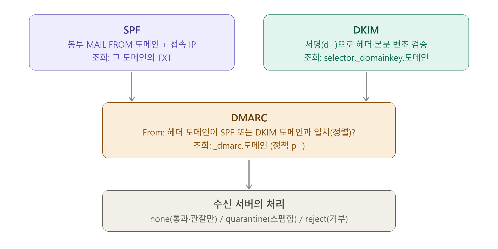

# 05_DNS와 스팸/인증

> 수신 서버의 검증 방법

수신 서버가 "이 메일이 정말 해당 도메인에서 온 것인가"를 판단하는 기준

## 1. DNS

> Domain Name System

메일은 여러 종류의 DNS 레코드를 사용한다.

| 레코드       | 풀네임         | 메일에서의 용도                            |
| ------------ | -------------- | ------------------------------------------ |
| `MX`         | Mail Exchanger | 도메인의 수신 서버 지정                    |
| `A` / `AAAA` | Address        | 서버 이름 → IPv4 / IPv6 주소 (정방향 조회) |
| `PTR`        | Pointer        | IP → 서버 이름 (역방향 조회)               |
| `TXT`        | Text           | SPF, DKIM, DMARC 정책을 문자열로 저장      |
| `CNAME`      | Canonical Name | 이름의 별칭                                |

### 1) MX

```
$ dig MX example.com +short
10 mx1.example.com.
20 mx2.example.com.
```

- mx 레코드는 우선순위가 존재한다. mx 레코드 조회 시 앞에 있는 숫자는 우선순위를 의미하며 우선순위가 작을 수록 먼저 시도한다.
- mx는 서버 이름 (A 레코드가 있는 이름)을 가리켜야 하고, IP를 직접 적거나 CNAME을 가리키면 안 된다.
- mx가 아예 없을 경우에는 도메인의 A레코드로 폴백한다.
- mx 레코드 변경 이후 이전 레코드의 캐시가 TTL만큼 남아있어 변경된 내용 반영까지 시간이 걸릴 수도 있다. (메일 수/발신에 이슈가 있을 가능성)

<br>

### 2) A레코드와 CNAME

<br>

### 3) PTR

역방향 DNS라고도 하며, **발신 서버의 IP가 어떤 이름으로 등록되어 있는지 확인**하기 위해 사용하는 레코드이다.

수신 서버는 다수는 다음 내용을 확인한다.

- IP에 PTR이 있는가 (PTR 레코드 존재 여부)
- PTR이 가리키는 이름을 다시 조회(A레코드, 정방향 조회)하면 같은 IP가 나오는가
- EHLO 이름과도 일관되는가

```bash
$ dig -x 198.51.100.10 +short
mail.sender.com.
$ dig A mail.sender.com +short
198.51.100.10
```

PTR 레코드가 없거나 PTR - A 레코드 조회 시 어긋나는 사항이 있을 경우 스팸 점수가 오르거나 거절될 가능성이 있다.

PTR 레코드의 경우 IP를 소유한 쪽에서 설정해줘야 하는 부분이기 때문에 ISP, CSP 측에서 설정해줘야 한다. (도메인 호스팅 업체에서 설정 불가능한 정보)

<br>

### 4) TXT

TXT 레코드는 종종 SPF 레코드라고도 하며, **"이 도메인으로 보낼 수 있는 서버(IP) 목록**"을 의미한다. 이를 DNS에 공개하여 해당 서버가 해당 도메인으로 메일을 보낼 수 있는지 확인하는 방식이다.

#### (1) SPF (Sender Policy Framework)

이 도메인으로 보낼 수 있는 서버 IP 목록을 DNS에 공개하는 형태이다.

```
example.com.  TXT  "v=spf1 ip4:198.51.100.0/24 include:_spf.mailservice.com mx -all"
```

- 위 SPF 레코드를 해석하면 "봉투 MAIL FROM이 @example.com인 메일은 3가지 ip (단일, 대역, 목록)중 하나에 해당하는 곳에서 올 때만 정상이고 나머지는 전부 실패 처리해라"는 의미이다.
  - `example.com`: 봉투의 MAIL FROM이 해당 도메인일 경우 해당 SPF 레코드 검증.
  - `v=spf1`: 이 레코드는 SPF 레코드이다.
  - 3개의 ip 및 대역에서만 허용한다.
    -  `ip4:198.51.100.0/24`로 198.51.100.0 ~ 198.51.100.255 (256개)
    - `include:_spf.mailservice.com`: 발송 대행사 `mailservice.com`이 공개한 SPF 목록(을 가져와서 검사하여 그 목록에 있는 ip면 허용)
    - `mx`: example.com의 mx 레코드가 가리키는 서버 ip를 허용 (수신 서버가 발송도 한다고 보는 것)
  - `-all`: 봉투의 도메인이 위 ip와 하나도 안 맞으면 실패 처리해라
- SPF 레코드 평가 방식은 **왼쪽부터 우측으로 순서대로 검사**하고, 처음 매칭된 항목의 결과로 확정한다.
- **도메인 당 SPF 레코드는 1개만 허용**된다. 만약에 SPF 레코드가 여러 개 있을 경우 수신 서버 측에서는 어느 SPF 레코드를 기준으로 도메인 검증을 할지 알 수 없기 때문에 메일 발신이 실패할 수도 있다. (TXT 레코드 자체가 여러 개인 건 정상. `v1=spf`로 시작하는 TXT 레코드가 2개 이상인 것은 비정상)
- 검증 흐름: 수신 서버가 MAIL FROM 도메인의 TXT 레코드를 조회하고, 지금 접속한 IP가 SPF 레코드에 있는지 확인한다. 만약 MAIL FROM이 비어있는 반송 메일(`<>`)일 경우 EHLO 이름의 도메인으로 검사한다.
  - `pass`: 허용된 IP
  - `fail` / `soft fail`: 목록에 없음(`-all` / `~all`)
  - `neutral`: 판단하지 않음(`?all`)
  - `none`: SPF 레코드가 없음
  - `temperror`: DNS조회 일시 오류
  - `permerror`: 레코드 문법 오류(SPF 레코드가 2개 이상일 경우 등), 조회 제한 초과 등

#### (2) DKIM (Domain Keys Identified Mail)

발신 서버가 비공개키로 서명해서 `DKIM-Signature` 헤더를 붙이고, 수신 서버가 DNS에서 공개키를 조회해서 검증한다.

```
DKIM-Signature: v=1; a=rsa-sha256; d=company.com; s=sel1;
  c=relaxed/relaxed; h=from:to:subject:date:message-id;
  bh=(본문 해시); b=(서명값)
```

- 태그의 의미
  - `d=`: 서명 도메인 (DMARC 정렬 판단에 사용)
  - `s=`: selector (셀렉터). 공개키를 찾는 이름표
  - `h=`: 서명 대상 헤더 목록 (여기 없는 헤더는 보호 안 됨)
  - `bh=` / `b=`: 본문 해시 / 서명값
  - `c=`: 정규화 방식 (relaxed: 공백, 줄바꿈 변화 어느 정도 허용)
  - `a=`: 암호화 알고리즘

- 수신 서버가 사용할 공개키는 `<selector>._domainkey.<도메인>` 형태로 TXT 레코드 검색 시 확인 가능하다.

```
sel1._domainkey.company.com.  TXT  "v=DKIM1; k=rsa; p=(공개키)"
```

- DKIM 결과가 fail이 되는 흔한 경우
  - 중간 서버가 서명 이후에 내용을 수정: 제목에 태그 추가, 면책 문구 삽입, 링크 재작성 등
  - DNS에 공개키가 없거나 selector 오타
  - 키를 교체하면서 이전 selector를 삭제해서, 이미 서명된 메일을 검증하지 못하는 경우

#### (3) DMARC (Domain-based Message Authentication, Reporting and Conformance)

SPF와 DKIM 결과를 헤더 `From:` 도메인과 연결하고, 실패 시 처리 정책을 정함.

```
_dmarc.company.com.  TXT  "v=DMARC1; p=quarantine; rua=mailto:dmarc@company.com; adkim=r; aspf=r"
```

- 태그의 의미
  - `p=`: 검증 실패 시 정책
    - `none`: 관찰만, 별도 조치 없음
    - `quarantine`: 스팸함으로 격리
    - `reject`: 거부
  - `sp=`: 서브 도메인에 적용할 정책
  - `rua=`: 집계 리포트를 받을 주소
  - `pct=`: 정책 적용 비율 (0, 50, 100)
  - `adkim=` / `aspf=`: 정렬 엄격도
    - `r`: relaxed. 같은 조직 도메인이면 허용
    - `s`: strict. 정확한 일치

- DMARC 통과 조건: 아래 둘 중 하나만 만족해도 통과
  - SPF 결과 pass && MAIL FROM 도메인이 From: 도메인과 일치 여부
  - DKIM 결과 pass && d= 도메인이 From: 도메인과 일치 여부

```
From: news@company.com
MAIL FROM: bounce@mailservice.com   → SPF pass, 그러나 company.com과 불일치
DKIM d=mailservice.com               → DKIM pass, 그러나 company.com과 불일치
=> DMARC fail
```

- 대행사를 쓰면 보통 `MAIL FROM`이 대행사 도메인이라서, SPF 경로는 `From:` 도메인과 일치하지 않아 DMARC 통과에 실패한다.(SPF는 pass여도 DMARC는 fail.) 이때 DMARC를 통과시키려면 DKIM 설정이 있어야 하며, DKIM 서명 도메인(`d=`)을 자사 도메인으로 설정해야 합니다.



<br>

## 2. 스팸 판정과 인증 결과

### 1) 스팸 판정

#### (1) 스팸 판정 요소

- 발신 IP와 도메인의 평판
- 인증 결과(SPF, DKIM, DMARC), PTR과 EHLO 일관성
- 내용 분석: 키워드, URL, 첨부 형식 등 컨텐츠
- 발신 행동: 대량 발송, 갑작스러운 증가, 존재하지 않는 수신자로의 발송 비율 등
- 수신자 반응: 수신자의 스팸 신고 등

많은 서버가 규칙별 점수를 합산해 임계값을 넘으면 스팸으로 판단하는 점수제를 사용한다.

#### (2) 판정 시점에 따른 증상

| 시점                            | 결과             | 발신자 입장              |
| ------------------------------- | ---------------- | ------------------------ |
| 연결 단계 (IP 차단)             | 거절 (일시 거절) | 즉시 오류 또는 지연, NDR |
| SMTP 대화 중 (`RCPT`m `.` 이후) | `5xx` 거절       | NDR 반송 메일            |
| 접수 후 분류                    | 스팸 메일함      |                          |

"보냈는데 상대가 못 받았고 NDR도 없다"면 접수 후 스팸함 분류를 의심 가능

#### (3) 블랙리스트(DNSBL)

스팸 발송 이력이 있는 IP를 모아둔 목록이고, DNS 질의로 등재 여부를 확인 가능. 

- IP를 점 단위로 뒤집어서 다음 명령어를 날리면 됨. (198.51.100.10인 경우)

```
dig +short 10.100.51.198 dnsbl.example.org
```

응답(`127.0.0.x`)이면 블랙리스트에 등재된 것이다. (아무 출력이 없다면 등재되지 않았다는 의미)

### 2) 인증 결과

수신 서버는 검증 결과를 Authentication-Results 헤더로 남겨 기록한다.

```
Authentication-Results: mx.receiver.com;
    spf=pass (sender IP is 198.51.100.10) smtp.mailfrom=sender.com;
    dkim=pass header.d=sender.com header.s=sel1;
    dmarc=pass (p=quarantine) header.from=sender.com
```

- 읽는 순서:
  - 맨 앞 `mx.receiver.com`은 **검증한 서버**. 확인 시 우리 서버가 쓴 줄인지 먼저 확인합니다. 외부가 써 넣은 줄은 믿을 수 없다. (헤더이기 때문에 외부가 작성도 가능하기 때문)
  - `spf=`, `dkim=`, `dmarc=` 각각의 결과 확인
  - 도메인 3개를 비교
    - `smtp.mailfrom`: SPF가 검사한 봉투 발신자 도메인
    - `header.d`: DKIM 서명 도메인
    - `header.from`: DMARC 기준 From: 도메인

- 일부 서버의 경우 SPF 검증 결과만 `Received-SPF:` 헤더로 남기기도 한다.

<br>

### 3) 실무 검증 예시

#### (1) 발송한 메일이 자꾸 상대방 스팸 메일로 분류되는 경우

- 메일의 .eml 파일을 받아서 원문의 헤더 분석
- 상대 수신 서버의 검증 결과 확인 (Authentication-Results와 Received SPF:, 스팸관련 헤더; X-Spam-* 등)
- 우리 도메인 (발송자의 도메인)의 SPF, DKIM, DMARC 설정 확인
- 발신 IP의 도메인 주소와 PTR 레코드 일치 여부
- 발신 IP와 도메인의 블랙리스트 등재 여부
- 발송한 메일의 컨텐츠
- 상대방 서버의 스팸 차단 규칙 등

#### (2) 회사의 mx 서버를 새 서버로 변경했는데 일부 외부 메일이 옛날 서버로 가는 경우

- mx 레코드 확인(우선 순위 등)
- DNS 서버 간 동기화 불일치 (발신자가 어느 NS에 쿼리하느냐에 따라 결과 상이한 경우)
- TTL 캐시로 인한 문제일 수도 있어 TTL 타임 짧게 설정 및 무시 등
- 발신 측의 고정 라우팅은 없는지 체크